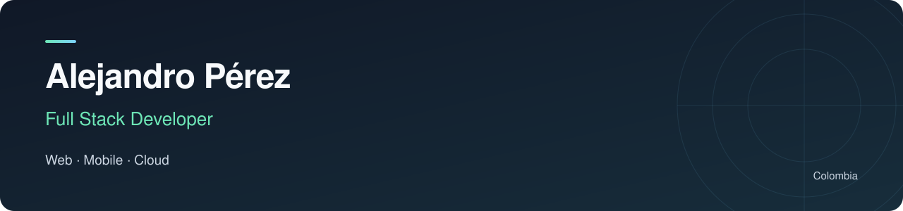
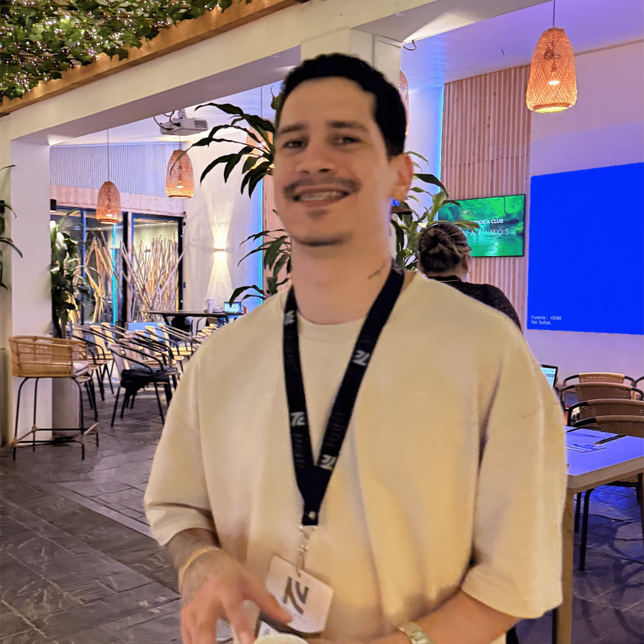

  

  

  <a href="https://www.linkedin.com/in/alejandroperezgranado/">LinkedIn</a> ·
  <a href="mailto:hola@alejoperez.dev">Email</a> ·
  <a href="https://www.crezka.top">Crezka</a>

I'm a **Full Stack Developer based in Colombia**, with **8+ years of experience** building web applications, mobile apps and SaaS platforms across fintech, e-commerce and digital assets.

I work across the stack: interfaces, APIs, service integrations, asynchronous messaging and cloud deployments. I also build my own products, where I turn business workflows into software people can use.

### What I work on

- **Web and mobile:** React, Next.js, Angular and Flutter applications, from customer experiences to operational dashboards.
- **Backend and integrations:** Node.js, NestJS and Laravel services, APIs, webhooks and event-driven communication with Pub/Sub, RabbitMQ and Redis.
- **Cloud and delivery:** AWS, GCP, CI/CD, service diagnostics and application maintenance.
- **Applied AI:** integrating OpenAI, Gemini and Claude into product workflows.

### Products I'm building

**[Crezka](https://www.crezka.top)**  
A business platform bringing together WhatsApp automation, AI assistance, online stores and point-of-sale workflows. My work spans a Next.js dashboard, backend services, background workers, real-time communication and companion Flutter apps.

**Take Your Pills**  
A Flutter medication reminder app that turns prescription schedules into dose reminders. Built around DDD and Clean Architecture, with local persistence, notification scheduling and Spanish prescription parsing. [Public support and privacy information →](https://github.com/alejandr0pg/takeyourpills-legal)

### Selected public projects

| Project | What you can explore | Stack |
| :--- | :--- | :--- |
| **[Incident & Status Portal](https://github.com/alejandr0pg/incident-status-portal)** | Incident management, audit logs, a public status API and infrastructure as code. | NestJS · Next.js · PostgreSQL · AWS CDK · ECS/Fargate |
| **[Shorty URL](https://github.com/alejandr0pg/shorty-url-laravel)** · [Frontend](https://github.com/alejandr0pg/shorty-url-react) | A URL shortener with a separate API and frontend, Docker setup and deployment documentation. | Laravel · React · TypeScript · AWS · GitHub Actions |
| **[ng-table-pg](https://github.com/alejandr0pg/ng-table-pg)** | A reusable Angular table with filtering, sorting, pagination, row reordering, exports and internationalization. | Angular · TypeScript · Angular CDK |

### Technical toolkit

| Area | Technologies |
| :--- | :--- |
| Frontend | TypeScript, JavaScript, React, Next.js, Angular |
| Mobile | Flutter, Dart, React Native, Ionic |
| Backend | Node.js, NestJS, Express, PHP, Laravel |
| Data and messaging | PostgreSQL, MySQL, SQL Server, MongoDB, Firebase, Redis, RabbitMQ, GCP Pub/Sub |
| Cloud and architecture | AWS, GCP, Docker, CI/CD, microservices, hexagonal architecture, DDD, Clean Architecture |
| Supporting tools | Python scripts for integrations and maintenance; SQL queries for data inspection |

### Experience

I've worked on fintech web and mobile services at **Vurelo**, SaaS and delivery pipelines at **Futswap**, and service integrations at **Intech Chain**. Earlier, I built web and mobile interfaces at **Rankmi** and **Tuten Labs**. I've also worked independently on CRM, ERP, content management and geolocation systems.

For my full work history, visit [LinkedIn](https://www.linkedin.com/in/alejandroperezgranado/).

---

**Let's connect:** [hola@alejoperez.dev](mailto:hola@alejoperez.dev)
