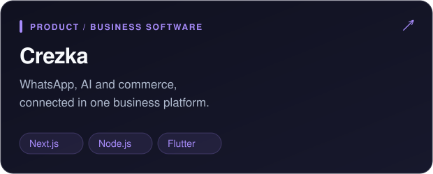
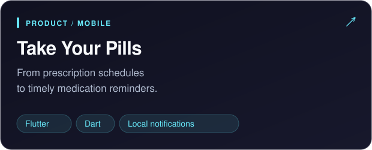
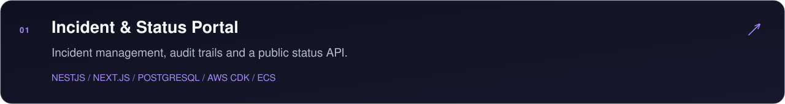
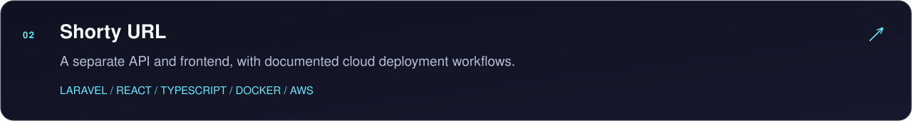
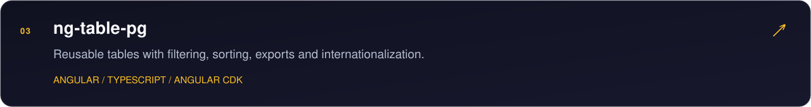
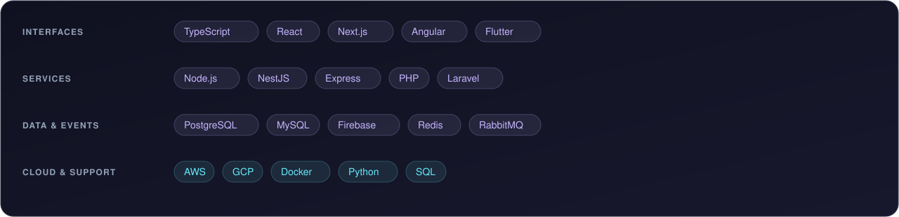
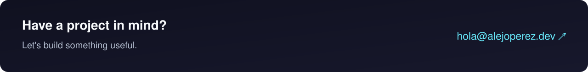

  

  <a href="https://www.linkedin.com/in/alejandroperezgranado/"><strong>LinkedIn ↗</strong></a>
  &nbsp;&nbsp;·&nbsp;&nbsp;
  <a href="mailto:hola@alejoperez.dev"><strong>Get in touch ↗</strong></a>
  &nbsp;&nbsp;·&nbsp;&nbsp;
  <a href="https://www.crezka.top"><strong>Explore Crezka ↗</strong></a>

 

I build **web applications, mobile apps and SaaS platforms**, with **8+ years of experience** across fintech, e-commerce and digital assets. My work connects interfaces, backend services and cloud infrastructure — from implementing a feature to integrating the services behind it.

I also build my own products, turning everyday business workflows into useful software.

 

### Products I'm building

  
  

**Crezka** brings together WhatsApp automation, AI assistance, online stores and point-of-sale workflows. I work across the dashboard, services, workers, real-time communication and companion apps.

**Take Your Pills** turns prescription schedules into dose reminders, using local persistence, notification scheduling and Spanish prescription parsing. Its card links to public support and privacy information.

 

### A few things you can explore

<a href="https://github.com/alejandr0pg/shorty-url-react">Explore the Shorty React frontend ↗</a>

 

### Tools behind the work

**How I work:** APIs and webhooks, event-driven services, microservices, DDD, Clean Architecture and CI/CD. I use **Python** for integration and maintenance scripts, and **SQL** to query and inspect data. My cloud experience includes **AWS**, **GCP** and **Pub/Sub**.

  
<strong>A little more about my experience</strong>

   

I've worked on fintech web and mobile services at **Vurelo**, SaaS platforms and delivery pipelines at **Futswap**, and integrations at **Intech Chain**. Earlier, I built web and mobile interfaces at **Rankmi** and **Tuten Labs**.

My independent work includes CRM, ERP, content management, geolocation systems and AI integrations with OpenAI, Gemini and Claude.

[Full work history on LinkedIn ↗](https://www.linkedin.com/in/alejandroperezgranado/)

 

