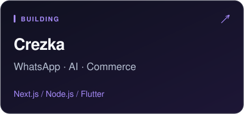
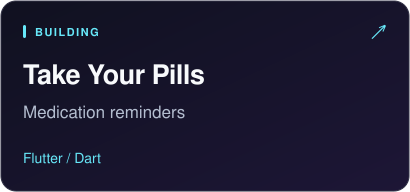
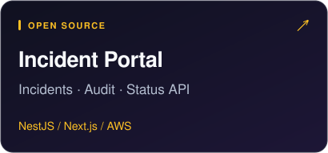

  I build <strong>web, mobile &amp; SaaS products</strong> across fintech and e-commerce. 
  Interfaces, APIs, integrations — all the way to the cloud.

  <strong>TypeScript · React · Next.js · Node.js · NestJS · Flutter</strong> 
  Python · SQL · AWS · GCP · AI integrations

  
  
  

  <a href="https://www.linkedin.com/in/alejandroperezgranado/"><strong>LinkedIn ↗</strong></a>
  &nbsp;&nbsp;·&nbsp;&nbsp;
  <a href="mailto:hola@alejoperez.dev"><strong>Let's talk ↗</strong></a>
  &nbsp;&nbsp;·&nbsp;&nbsp;
  <a href="https://github.com/alejandr0pg?tab=repositories"><strong>More projects ↗</strong></a>

